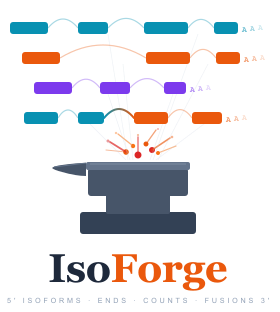
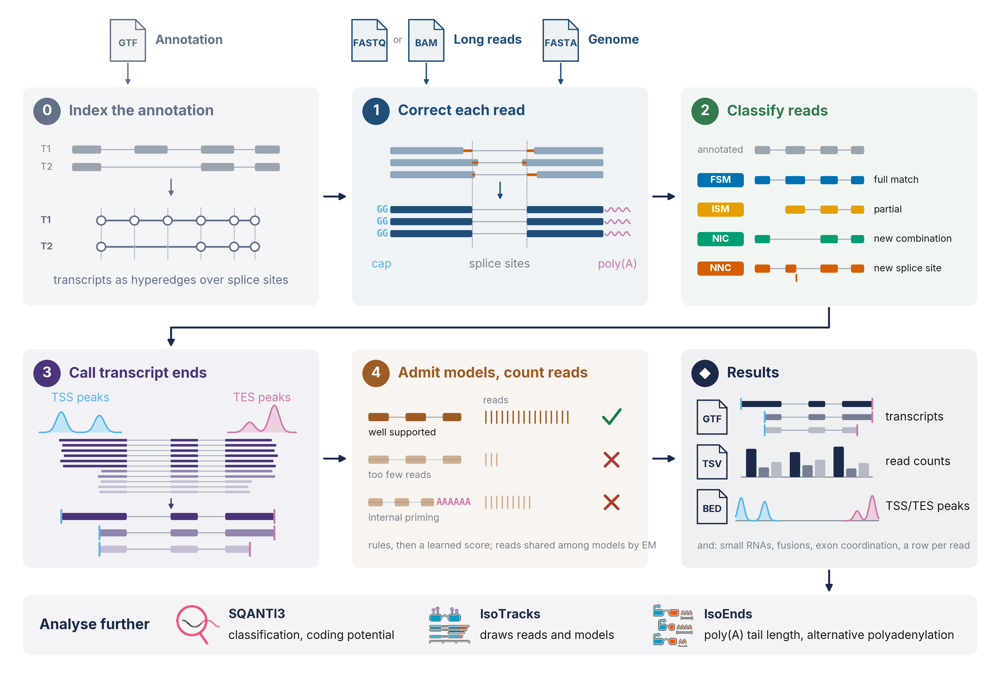

<p align="center">
  <picture>
    <source media="(prefers-color-scheme: dark)" srcset="illustrations/isoforge_logo_dark.svg">
    
  </picture>
</p>

IsoForge uses a hypergraph, rather than a splice graph, to preserve transcript models and the reads behind them.
Each long read is kept whole, with its intron chain and both ends, as one hyperedge. From Oxford Nanopore or PacBio
RNA-seq, a single run reports annotated and novel isoforms with their transcription start and poly(A) sites, read
counts per sample (annotated small RNAs included) and gene fusions.



## Installation

```bash
git clone https://github.com/MustafaElshani/IsoForge.git
cd IsoForge
bash install.sh              # creates the conda environment "isoforge" and builds into it
conda activate isoforge
```

IsoForge is built from source and is tested on Linux (x86-64). The script needs conda; it installs Python, Rust and
the C build tools into the environment. minimap2 and htslib are compiled in, so there is nothing else to install.

`bash install.sh --help` shows the other ways to call the script. Without it: `conda env create -f environment.yml`,
`conda activate isoforge`, `pip install .` In an environment of your own, `pip install .` needs Python 3.10 or later,
Rust 1.85 or later and the C build tools (a compiler, make, cmake).

## Quick start

IsoForge needs the reads, the genome and the annotation:

```bash
# from FASTQ
isoforge annotate --reads Control_1.fastq.gz Treated_1.fastq.gz \
    --genome hg38.fa --annotation gencode.v49.annotation.gtf --o results/project

# or from sorted BAM files
isoforge annotate --bam Control_1.bam Treated_1.bam \
    --genome hg38.fa --annotation gencode.v49.annotation.gtf --o results/project
```

FASTQ files are aligned with the minimap2 built into IsoForge. The annotation is indexed on the first run, beside the
GTF, and the index is used again after that. Every output is written; nothing else has to be set.

If your genome has a [minisplice](https://github.com/lh3/minisplice) score table
(human GRCh38: [human-GRCh38.v4.tsv.gz](https://zenodo.org/records/15931054)), add
`--splice_scores human-GRCh38.v4.tsv.gz`. It is used to place and check novel splice sites.

| Command | Use |
|---------|-----|
| `isoforge annotate` | The run: from FASTQ or BAM to transcript models, counts and fusions |
| `isoforge post` | Filter and write the outputs again from a kept run, without reading the alignments again |
| `isoforge export` | Write coverage tracks or the read table again from a finished run |
| `isoforge index` | Build the annotation index ahead of a run, for example on a cluster |

`isoforge <command> --help` shows the main options of a command, and `isoforge annotate --help-all` every option.

## Input

### Reads

Give one file per sample: FASTQ or FASTA, gzipped or not, with `--reads`, or sorted BAM with `--bam`. The samples
are named after their files unless `--names` gives the names. For FASTQ, set the library type:

| Library | Options | minimap2, if you align yourself |
|---------|---------|---------------------------------|
| Nanopore cDNA | none | `-ax splice` |
| Nanopore direct RNA, or cDNA oriented with pychopper | `--oriented -k 14` | `-ax splice -uf -k14` |
| PacBio Iso-Seq | `--platform hifi --oriented` | `-ax splice:hq -uf` |

`--oriented` (`-uf`) is only for reads that run in the transcript's direction. `--write_bam` keeps the alignments
IsoForge makes, which IsoTracks reads.

BAM files of your own must be aligned to the genome with minimap2, sorted and indexed:

```bash
minimap2 -ax splice --junc-bed annotation.bed hg38.fa reads.fastq.gz | samtools sort -o sample.bam
samtools index sample.bam
```

`annotation.bed` is made with `paftools.js gff2bed annotation.gtf`; `--junc_bed` gives the same file to the built-in
aligner.

Poly(A) tail lengths are read from the `pt:i` tag when the reads carry it, and measured in the soft clip otherwise.
To keep Dorado's tag, convert with `samtools fastq -T pt` and add `--copy_comment` (`minimap2 -y`).

### Sample sheet

For many samples, `--config` takes a CSV in place of `--reads` or `--bam`, with one sample per line: name,
description, platform and file.

```csv
Control_rep1,Control replicate 1,ONT,/data/control_rep1.fastq.gz
Control_rep2,Control replicate 2,ONT,/data/control_rep2.fastq.gz
Treated_rep1,Treated replicate 1,ONT,/data/treated_rep1.fastq.gz
Treated_rep2,Treated replicate 2,ONT,/data/treated_rep2.fastq.gz
```

The part of a sample name before the first underscore is the condition (`Control`, `Treated`).

## Output

With `--o results/project`:

| File | Content |
|------|---------|
| `project_isoforge.gtf` | Transcript models that pass the filters, with their TSS, poly(A) site and poly(A) signal |
| `project_isoforge_abundance_filtered.tsv` | Read counts per transcript and dataset |
| `project_isoforge_read_annot.parquet` | Every read: its transcript, TSS, poly(A) site and signal, and tail length |
| `project_isoforge_read_annot.tsv` | The whole reads of the reported transcripts, as text; their other reads are in `..._unsupported.tsv` |
| `project_isoforge_summary.tsv` | Genes, transcripts and reads per category and dataset |
| `project_filter.csv` | IDs of the transcripts that pass |
| `project_TSS_TES_Clusters/` | TSS and poly(A) site clusters (BED and Parquet), and read-end coverage tracks per dataset |
| `project_isoforge_fusions.tsv` | Fusion candidates. The calls are the rows with `PASS` in the `filter` column, also written as `.bedpe` |
| `project_isoforge_fusion_*` | The reads, parts and transcripts of each fusion (TSV, Parquet, GTF) |

`--hypergraph` also writes the read hypergraph of the reported models (`project_isoforge_hypergraph.tsv`) and tests of
which exons are spliced together in the same molecules (`project_isoforge_coordination.tsv`).

<details>
<summary>Transcript categories</summary>

| Category | Meaning |
|----------|---------|
| Known | Full splice match to an annotated transcript |
| ISM | Incomplete splice match: a contiguous part of an annotated intron chain (`Prefix`, `Suffix` or `Both`) |
| NIC | Novel in catalogue: annotated splice sites in a new combination |
| NNC | Novel not in catalogue: at least one new splice site |
| Novel | An intron chain given a new ID because its reads have a start or poly(A) site of their own |
| Antisense | On the opposite strand of an annotated gene |
| Intergenic | Outside annotated genes |
| Genomic | Overlaps an annotated gene without sharing its splice structure |
| Fusion | Spans two or more annotated genes |

</details>

<details>
<summary>Columns of the tables and GTF attributes</summary>

Abundance table:

| Column | Content |
|--------|---------|
| `gene_ID`, `transcript_ID` | IsoForge gene and transcript numbers |
| `annot_gene_id`, `annot_transcript_id` | Annotation IDs; novel transcripts are `ISOFORT…`, novel genes `ISOFORG…` |
| `annot_gene_name`, `annot_transcript_name` | Gene and transcript names |
| `n_exons`, `length` | Number of exons and transcript length (nt) |
| `gene_novelty`, `transcript_novelty`, `ISM_subtype` | Categories, as above |
| one column per dataset | Read counts. A read that fits several transcripts is shared among them, so counts can be fractional |

Read table:

| Column | Content |
|--------|---------|
| `read_name`, `dataset`, `genome_build` | Read, dataset and genome build |
| `chromosome`, `read_start`, `read_end`, `strand` | 5′ and 3′ end of the alignment (1-based) and transcript strand |
| `n_exons`, `read_length` | Exons of the assigned transcript, and length of the read |
| `gene_ID` … `ISM_subtype` | The assigned gene and transcript, as in the abundance table |
| `fraction_As` | A content of the 20 nt after the 3′ end |
| `custom_label`, `allelic_label` | The `lC` and `lA` BAM tags, if present |
| `start_support`, `end_support` | TSS and poly(A) cluster the read's ends joined |
| `tss_site`, `tss_feature` | TSS position and the annotated feature there |
| `polya_site`, `polya_feature`, `polya_signal` | Poly(A) site, the feature there and the poly(A) signal (a hexamer, or `DSE`) |
| `cluster_supported` | `True` for a whole read of its transcript: every exon, both ends at the transcript's, not internally primed |
| `polya_length` | Poly(A) tail length |

GTF transcript records carry `transcript_status`, `tss_site`, `tss_Feature`, `polyA_site`, `polyA_Feature` and
`polyA_signal`. A transcript that has the intron chain of an annotated one and another start or poly(A) site also
carries `variant_of`, the ID of that annotated transcript.

</details>

## Options

The defaults are meant to be run as they are. These are the options most often changed:

| Option | Default | Effect |
|--------|---------|--------|
| `--threads` | all cores | Threads |
| `--minCount` | 5 | Reads per dataset a novel transcript needs |
| `--minCountKnown` | 2 | Reads per dataset an annotated transcript needs |
| `--minDatasets` | 1 | Datasets in which a novel transcript must pass (0: all) |
| `--no_polya_filter` | off | Accept 3′ ends without a poly(A) tail, for reads without tail information |
| `--known_ends_as_annotated` | off | Write annotated transcripts at their annotated ends; the read-derived ends stay in the GTF attributes |
| `--no-small_rna` | counted | Do not count annotated small RNAs |
| `--no-fusions` | called | Do not call fusions |
| `--sj_dir`, `--cage_peaks` | none | STAR `SJ.out.tab` files and CAGE peaks as further evidence for splice sites and starts |
| `--read_annot_format parquet`, `--no-end_tracks` | both, on | A smaller output: no read table as text, no coverage tracks |
| `--write_bam` | off | Keep the alignments made from FASTQ, in `<prefix>_alignments/` |
| `--keep-db` | off | Keep the run database for `isoforge post` |

## Filtering a run again

A run kept with `--keep-db` can be filtered with other settings without reading the alignments again:

```bash
isoforge post --database results/project_isoforge_db --annotation gencode.v49.annotation.gtf \
    --genome hg38.fa --minCount 10 --o results/project_min10
```

`isoforge post` takes the filtering options of `isoforge annotate`. Give it `--genome` and `--splice_scores` as in
the run.

## Downstream analysis

| Tool | Use | Reads from a run |
|------|-----|------------------|
| [SQANTI3](https://github.com/ConesaLab/SQANTI3) v6 | Structural classification and quality control of the transcript models | The GTF |
| [IsoForge_Sqanti3](https://github.com/MustafaElshani/IsoForge_Sqanti3) | Runs SQANTI3 on a run and writes its classification, coding status and CDS back into the GTF, with a BED12 for genome browsers | The GTF |
| [IsoTracks](https://github.com/MustafaElshani/IsoTracks) | Draws the isoform models of a gene with the reads behind them, their poly(A) tails and coverage, and gene fusions | The GTF, the read-annotation Parquet, the clusters, the fusion tables and the BAM files |
| [IsoEnds](https://github.com/MustafaElshani/IsoEnds) | Statistics on poly(A) tail length, alternative polyadenylation and transcription start sites between conditions | The read-annotation Parquet, the GTF and the clusters |

IsoForge_Sqanti3, IsoTracks and IsoEnds are companion tools of IsoForge. SQANTI3 itself takes the GTF as it is:

```bash
python sqanti3_qc.py --isoforms results/project_isoforge.gtf \
    --refGTF gencode.v49.annotation.gtf --refFasta hg38.fa -d results/sqanti3 -o project
```

## Citation

The IsoForge manuscript is in preparation. Until it is out, please cite this repository:

> Elshani M, Zhang Y, Harrison DJ. IsoForge, version 1.0.0. https://github.com/MustafaElshani/IsoForge

## License

MIT, see [LICENSE](LICENSE).
